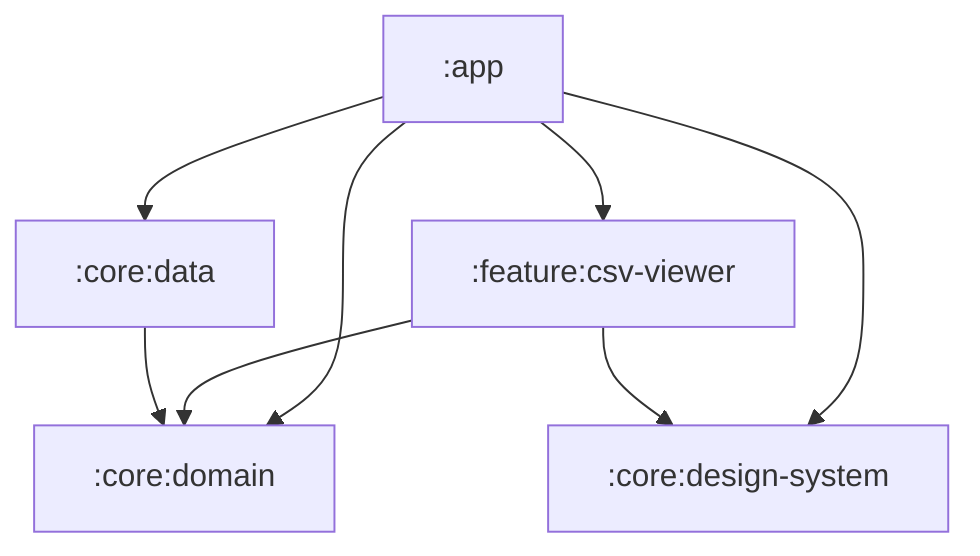

# CsvParsely

A take-home assignment for Rabobank.

An Android app that downloads a CSV file, converts every value to a string, an integer or a date, and shows the rows as
cards. The parser is hand-written (no CSV library), and the column types are decided from the content, so the app works
on any well-formed comma-separated file, not only on the sample.

Kotlin, Jetpack Compose with Material 3, Hilt, OkHttp, Coil and coroutines. `minSdk` 26, `targetSdk` 37.

## Architecture

Clean architecture in five modules, with MVVM and a one-way data flow on the screen.



| Module | Type | Holds |
|---|---|---|
| `:app` | application | `@HiltAndroidApp`, `MainActivity`, all Hilt modules (network, dispatchers, data) |
| `:feature:csv-viewer` | Android library | `CsvViewerViewModel`, UI state and event, screen composables, string resources |
| `:core:domain` | pure Kotlin/JVM | models, `CsvError`, the `CsvRepository` interface, column type inference, `LoadCsvTableUseCase` |
| `:core:data` | Android library | `CsvDownloader` (OkHttp), `CsvParser`, `CsvRepositoryImpl` |
| `:core:design-system` | Android library | the theme (Rabobank colors, light and dark) |
| `:build-logic` | included build | convention plugins, so each module's build file is a few lines |

The feature never depends on `:core:data`: only `:app` sees both sides, and binds the repository with Hilt.
`:core:domain` has no Android dependency, so its tests are plain JVM tests.

### Data flow

```
CsvViewerScreen --CsvEvent.Retry--> CsvViewerViewModel --> LoadCsvTableUseCase --> CsvRepository
      ^                                    |                                          (download, then parse)
      +------ StateFlow<CsvUiState> -------+
```

1. **Download**: `CsvDownloader` copies the response body into `cacheDir/csv/download.csv`, replacing the previous
   file. A canceled download cancels the OkHttp call, so a blocked read stops at once. No temporary file is needed:
   a failed download throws, so its partial file is never parsed, and only one load runs at a time (Retry is accepted
   only after a failure), so a canceled download can't write into the file of a newer one.
2. **Parse**: `CsvParser` reads the file character by character into a header and rows of raw text.
3. **Type**: `LoadCsvTableUseCase` decides each column's type on the default dispatcher and returns a
   `Result<CsvTable>`. The table keeps the raw text and converts a row only when the screen reads it.
4. **Show**: the ViewModel loads in `init`, so a configuration change doesn't download again. `CsvUiState(isLoading,
   table, error)` is one data class, so the list, the loading indicator, the empty state and the error snackbar are
   each shown on their own.

## Parsing rules

- Fields are separated by commas. A field in double quotes can hold commas, line breaks and `""` (one literal quote).
- CRLF, LF and CR all end a record, and the last record may have no line ending.
- A UTF-8 byte order mark at the start is ignored.
- Empty lines are skipped, except in a single-column file, where an empty line is a row with an empty value. A line
  with only `""` is always a row.
- The first record is the header. A row shorter than the header is padded with empty values; a row longer than the
  header adds unnamed columns (shown as `Column <n>`).
- Text is read as UTF-8. A file that is not valid UTF-8 is read again as Windows-1252, the default of Excel on Windows.
- A quoted field that is never closed fails with the line where the quote opened. A file with no records fails as
  empty.

## Type rules

Each column gets one type, decided from all its non-empty values (surrounding whitespace is ignored):

| Type | When every non-empty value is | Examples |
|---|---|---|
| INTEGER | a whole number, optionally signed, without leading zeros, that fits in a `Long` | `-3`, `0`, `+12` (but `0123`, `1.5` are text) |
| DATE | an ISO-8601 date, date-time or date-time with an offset, years 1 to 9999 (`java.time` ISO parsers, strict) | `2001-04-20`, `1978-01-02T00:00:00`, `2001-04-20T10:15+02:00` |
| TEXT | anything else, kept exactly as written | `Theo`, `2023-02-30` |

- A column with only empty values is TEXT. An empty value in an INTEGER or DATE column is shown as `-`.
- In a TEXT column, a value that is an `https` URL whose path ends in `.png`, `.jpg`, `.jpeg`, `.gif` or `.webp` is
  shown as an image (loaded with Coil, a default avatar while loading or when it fails). The column stays TEXT, so a
  column that mixes image URLs and names shows each value as it is.
- Dates are shown in the device's locale format, with a 24-hour time when the file gives one. A date-time with an
  offset is converted to the device's time zone; one without an offset is shown as written (a date of birth must never
  move to another day).

## Errors

Every failure becomes a `CsvError`, shown in a snackbar that stays on screen (also after a configuration change).
Retry is offered only when a second try can help: no connection, and HTTP 408, 429 and 5xx.

| Error | When | Retry |
|---|---|---|
| `Network` | the server can't be reached, or the connection drops | yes |
| `Http(code)` | a non-2xx answer | 408, 429, 5xx only |
| `Storage` | the file can't be created or written on the phone | no |
| `EmptyFile` | the file has no records | no |
| `Malformed(line)` | a quote opened on `line` is never closed | no |
| `FileTooLarge` | the app ran out of memory while loading | no |
| `Generic` | anything unexpected | no |

The use case catches everything (`runCatching`) and rethrows only a `CancellationException`. That includes JVM errors:
an `OutOfMemoryError` while loading becomes `FileTooLarge` instead of a crash, and its memory is freed once the load
fails, so the app keeps running.

## Known limits

- **Memory**: the parser streams the file, but the parsed rows are kept in memory as raw text (cells are converted only
  when a row is shown). A file larger than the available memory fails with `FileTooLarge`. Measured on a Pixel 8
  (256 MB heap), debug build: 100,000 rows are parsed and typed in 4.3 s and 1,000,000 rows in 34 s (times include
  writing the test file). With 1,000,000 rows on screen, the Java heap stayed flat at 47 MB while scrolling; over 60
  flings, 4.5% of frames were janky (median 9 ms, 99th percentile 34 ms) and nothing crashed.
- **A row that fails to convert while scrolling crashes the app.** `CsvTable.row()` runs outside the use case, so a
  failure there is not caught. Only an `OutOfMemoryError` or a bug in the app can cause it: the load needs more memory
  than the screen does afterwards, and the conversion uses the same checks that decided the column type. Catching it
  would not help, since whatever is shown instead needs memory that may not be there.
- **Comma only**: a file separated by `;` or tabs shows each line as a single TEXT column.
- **ISO dates only**: dates in another format (`20-04-2001`, `04/20/2001`) are shown as TEXT.
- **Encodings**: only UTF-8 and Windows-1252 are read correctly. A file in another encoding still loads, but its
  non-ASCII letters show garbled.

## Build and test

Open the project in Android Studio, or use the Gradle wrapper (JDK 17 or newer).

```bash
# Build and install the debug app on a connected device or emulator
./gradlew installDebug

# JVM unit tests of all modules: parser, type inference, download (MockWebServer), use case, ViewModel,
# and an integration test from HTTP to the typed table
./gradlew test

# Instrumented tests, on a connected device or emulator: Compose UI tests of the screen, and a 100,000-row
# parse and type run on the device
./gradlew connectedDebugAndroidTest
```

## How AI was used

Claude Code assisted me while building this app; it was not vibe coded. I made every decision, reviewed each step and changed the code myself whenever I thought it was needed:
the work was split into small tasks, each one in its own pull request that I reviewed before merging. The planning was
done with OpenSpec, a tool for writing down what to build (proposal, design, specs and tasks) before writing the code.
I used it mainly to try out and practise AI-assisted spec-driven development on a real, small project. The proposal, design (with the alternatives considered), specs and task list are in `openspec/`.
